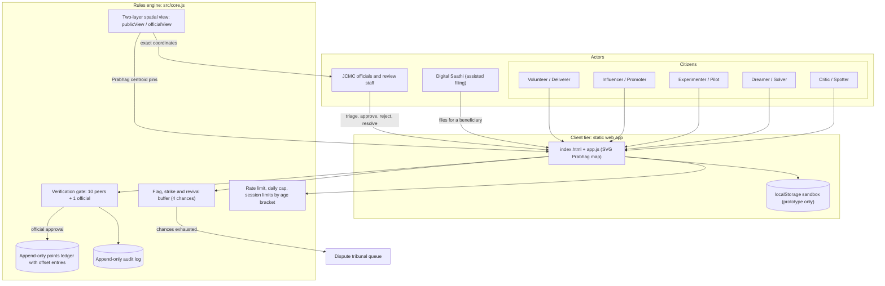
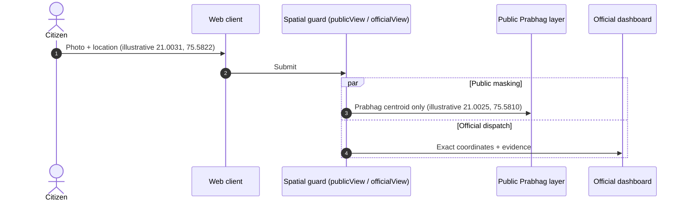
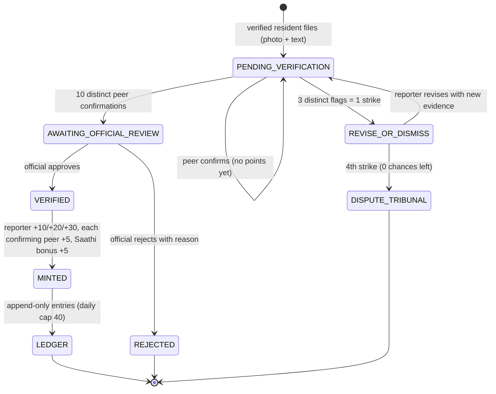
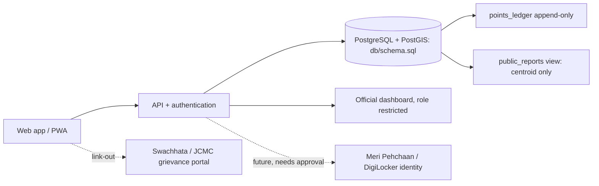
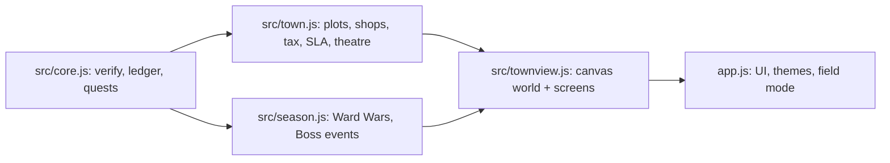

# Architecture

e-Karmakshetra is a **trust architecture for civic participation**: public transparency without exposing private data,
verification before recognition, and an auditable record of every action. This document describes (A) what the
browser prototype implements today and (B) the production design it is a vertical slice of.

## 1. Actors and principles
Citizens act in five roles: Critic/Spotter, Dreamer/Solver, Experimenter/Pilot, Influencer/Promoter, Volunteer/Deliverer.
Municipal actors are JCMC ward officials, municipal staff and review/triage teams. Digital Saathi volunteers file on behalf
of people who cannot use a smartphone.

Principles: transparency without private data; verification before rewards; accountability over vanity metrics;
inclusion; anti-abuse safeguards; privacy-first telemetry.

## 2. High-level architecture

## 3. Two-layer spatial privacy
Under DPDP principles, residential addresses and precise location must not be public.
- **Public layer:** every submission is displayed at the **centroid of its Prabhag**, with a pseudonym (or "Anonymous resident").
- **Official layer:** exact coordinates, photo evidence and timestamps are visible only to authenticated officials.

Coordinates in this repository are illustrative points near Jalgaon. Prabhag centroids and boundaries in the sample data are
**invented**; official JCMC boundaries must be loaded for a real pilot.

## 4. Verification and points state machine

| Submission type | Role | Points on VERIFIED |
| --- | --- | --- |
| hazard | Critic / Spotter | 10 |
| solution, campaign, delivery | Dreamer, Influencer, Deliverer | 20 |
| pilot proof | Experimenter / Pilot | 30 |

## 5. Safeguards
| Safeguard | Threat | Enforcement (tested in `tests/core.test.js`) |
| --- | --- | --- |
| Two-layer map | Stalking, profiling | `publicView` omits exact coordinates; `officialView` for officials only |
| 10 peers + 1 official | Spam, fabricated complaints | Status moves only after both gates |
| Peer points paid after official approval | Collusion rings farming confirmations | Points minted in `officialApprove`, never at confirmation |
| 3 flags per strike, 4 chances | Fake reports and flag-griefing | Distinct-flagger threshold; revision resets confirmations |
| Digital Saathi | Digital divide | Saathi-only assisted filing with bonus |
| Session limits and breaks | Overuse | Limits by age bracket; wellness prompt every 20 minutes |
| Append-only ledger | Score tampering | Frozen entries; corrections are signed OFFSET entries by officials |
| Rate limit | Spam | 5 filings per user per day |
| Duplicate detection | Fake accounts and spam | Same name and Prabhag, same pseudonym, same text blocked |
| Audit trail | Disputes | Every action recorded with actor and reference |
| XSS-safe rendering | Script injection | All user text rendered with `textContent` |

## 6. Production design (roadmap)

`db/schema.sql` is the reference schema (PostGIS geography points, constraints, append-only triggers, public view).
It has not been run against a live database in this repository's tests.

## 7. Governance and scale
Public, restricted and audit layers are separate. The same rules engine can move behind a server; thresholds (peers needed,
flag count, caps) are configuration. If abuse rises, thresholds rise; for a small pilot, an official may lower the peer
threshold for demonstration only (the policy value is 10).

## References
Digital Personal Data Protection Act principles; participatory-design literature (Arnstein 1969); self-determination research
on rewards (Deci, Koestner and Ryan 1999). Full list in the project dossier.

## Optional shared demo mode

`src/sync.js` can store the whole demo state at `rooms/<room>/state` in a Firebase Realtime Database. Every action runs inside a database transaction (`SYNC.transact`), so concurrent users do not overwrite each other. It is disabled unless `firebase-config.js` provides a config, and falls back to local mode on failure. Limitation: rules are enforced in client code and the room is open to anyone with the link; production would enforce rules server-side. See `docs/SHARED_MODE.md`.

## Town layer (v7)

`src/town.js` adds plots, storefronts, tax, SLA escalation, roles, disputes and theatre on top of `src/core.js`. Points move only through double-entry ledger pairs (SPEND/RECEIVE), so totals are conserved; XP counts EARN and OFFSET entries only. `src/townview.js` draws the canvas world and screens. See `docs/TOWN.md`.

`src/season.js` computes Ward Wars and Boss events purely from the existing reports and audit trail (no new stored state except one Quest-XP claim per boss).
